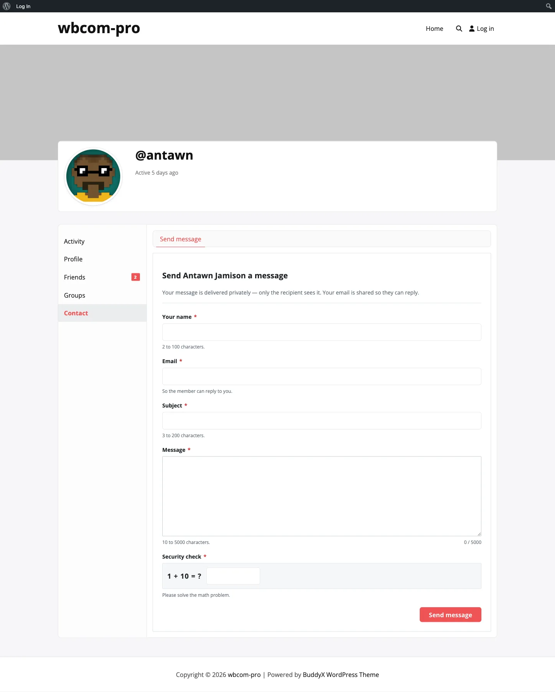

# Guest Contact with Captcha & Spam Protection

Logged-out visitors can reach members through the same contact form, with two extra fields and a built-in spam defence.

## Enabling guest contact

1. Go to **WB Plugins → Contact Me → Access**.
2. In the **Who can send messages** group, tick **Visitors (not logged in)**.
3. Save.

If the checkbox is unchecked, the form returns a "You are not allowed to send messages." error for any unauthenticated submission.

## What the visitor sees

Three extra fields appear when no user is logged in:

- **Your name** - required, 2 to 100 characters.
- **Email** - required, must pass `is_email()`; the recipient uses this to reply.
- **Security check** - a math question such as "What is 7 plus 4?", or the site's CAPTCHA service when the Wbcom CAPTCHA Manager plugin is active.

The subject and message fields are the same as the logged-in version (3–200 and 10–5000 characters).

## Security check: how it works

When the form renders, the server picks a random sum, stores the answer on the server for 30 minutes, and puts only a random token in the form. On submit the typed answer is checked against the stored one, and the question is used up once the message is saved, so it cannot be replayed. After a successful send the form gets a fresh question without a page reload.

If the Wbcom CAPTCHA Manager plugin is active and a service is turned on, guests get that service (for example Turnstile or reCAPTCHA) instead of the math question, under the form name `contact_me`.

Members never see a security check.

## Hidden trap field and send limit

- The guest form carries a hidden field that people never see or fill. Bots that fill every field are rejected as spam.
- Each sender can send 5 messages in 10 minutes: members are counted by account, visitors by IP address. The next message is refused with "You have sent several messages in a short time. Please wait a few minutes and try again." Change the limit with the `bcm_rate_limit` filter.

## Spam heuristic

After the captcha passes, the message body runs through a built-in regex screen (`looks_like_spam` in `class-bcm-frontend-submit.php`) that flags submissions matching obvious patterns:

- Pharma terms (viagra, cialis, levitra, pharmacy, pills, medication).
- Gambling terms (casino, poker, blackjack, slots, gambling).
- Loan / debt offers ("loan offer", "credit approval", "mortgage rate").
- Aggressive call-to-action phrasing ("click here", "buy now", "limited time").
- Lottery / prize spam ("you won", "congratulations winner", "million dollar").
- Three or more URLs in the same message body.

A flagged submission is rejected with the message "Your message was flagged as spam. Please rephrase and try again." The result is filterable via `bcm_spam_check` (see [Hooks & filters](../developer-guide/hooks-and-filters.md)) so you can soften, harden, or replace the heuristic without forking the plugin.

## What the recipient gets

Guest submissions land in the same inbox as member submissions, with a "Guest" badge to make the source obvious. The recipient sees the reply address the visitor typed and can reply by email, but cannot start a BuddyPress private message because the sender has no account.

Visitors do not get a copy of their message by email, even when **Sender copy** is on. That copy goes to logged-in members only, so the form cannot be used to send email to any address someone types in.
