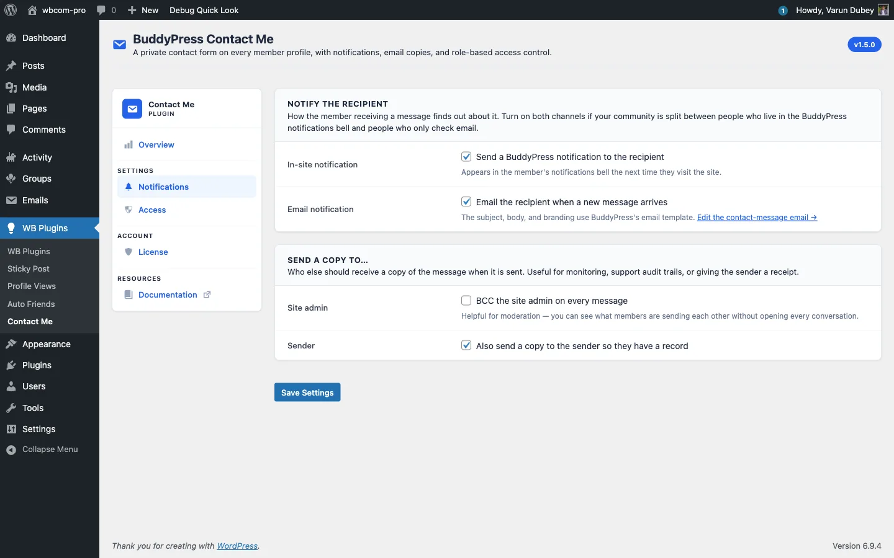

# BuddyPress Notifications & Email Delivery

Every contact-message submission can fire a BuddyPress in-site notification, an email, or both. Both run on the recipient's behalf - they are notified, the sender just sees a "Message sent" confirmation.

## In-site notifications

Powered by the BuddyPress Notifications component. When enabled:

- A new entry appears in the recipient's notification bell.
- The entry text reads "{Sender display name} sent you a contact message." and links to `/contact/inbox/{message-id}/`.
- When several messages are unread, BuddyPress groups them into one entry, "You have N new contact messages", that opens the inbox.
- Opening the message clears the notification automatically - see [Single message view](single-message-view.md).

If the BuddyPress Notifications component is disabled site-wide, this channel silently no-ops; nothing breaks.

The plugin registers itself as a notifications component named `bcm_user_notifications` with action slug `bcm_user_notifications_action` so it shows up alongside core BP notifications and respects the user's per-component email preferences if you use a plugin like BP Notifications Manager.

## Email notifications

Powered by `bp_send_email()` and a dedicated email post of type `bcm-contact-message`, installed on activation and on each version update if it is missing. Because it goes through the BuddyPress email pipeline:

- The email uses the same header, body card, footer, and unsubscribe link as every other BuddyPress email on the site - no theme work required.
- Site admins can edit the subject and body from **Dashboard → Emails** and find the entry whose subject reads "[Site name] Sender name sent you a contact message". Once an admin edits it, future plugin upgrades never overwrite their changes.
- The available tokens are `{{sender.name}}`, `{{contact.recipient}}`, `{{contact.subject}}`, `{{contact.message}}`, and `{{{inbox.url}}}` (triple-braces because it embeds a URL). BP-native tokens like `{{{site.name}}}` and `{{unsubscribe}}` are also available.

See the [Email pipeline](../developer-guide/email-pipeline.md) developer doc for the exact token list and post structure.

## Send-a-copy options

Two extra recipient toggles on the Notifications tab:

- **Site admin copy** - every user with the `administrator` role gets their own copy of each message, as a separate email. Useful for community moderation.
- **Sender copy** - send a logged-in sender a copy of what they submitted, as a "we got your message" receipt. Visitors never get a copy, so the form cannot be used to send email to an address someone typed in.

## Per-recipient delivery

Each reader gets their own email: the member, the sender copy and one email per site administrator. There is no CC or BCC, so nobody sees another person's email address.

## Output buffering safety

Because `bp_send_email()` runs inside the REST submit callback, the plugin output-buffers the call so that any third-party hook emitting a stray notice or whitespace cannot break the JSON response. Leaked output is captured and logged via `error_log()` when `WP_DEBUG` is on, never printed to the response stream.
