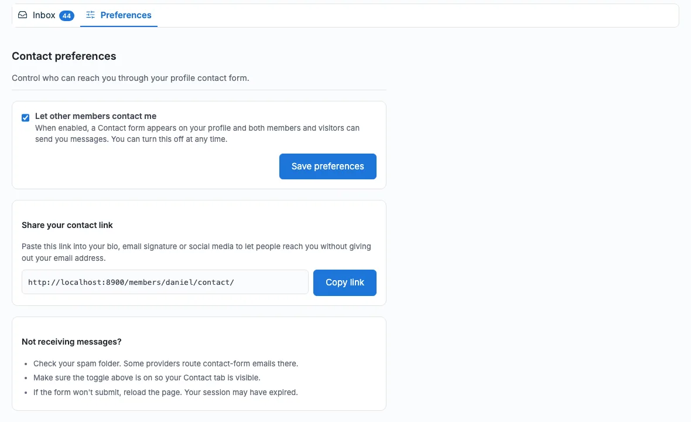

# Per-Member Opt-Out

Even when an admin's role allow-list says a member can be contacted, every member keeps a personal opt-out switch. Privacy stays in the user's hands.



## Where members find the toggle

1. Member opens their own profile and clicks **Contact**.
2. Clicks **Preferences** in the Contact sub-nav.
3. Unticks **Let other members contact me**.
4. Clicks **Save preferences**. A "Preferences saved." notice confirms the change.

This is the only place the switch lives. Versions before 1.5.1 also showed a copy of it on **Settings > General**, which did not save reliably; that copy was removed.

## What "opt-out" actually does

When a member opts out, two things happen:

- The "Contact" tab disappears from their public profile.
- Submissions targeted at them via `[buddypress-contact-me id=...]` shortcode return an empty render.

The member's own Contact tab stays: they can still read their Inbox, open older messages from notification and email links, and turn contact back on under Preferences.

The user's `contact_me_button` user-meta is set to `'off'`. Every check (`BCM_Frontend_Nav::user_accepts_contact()`) short-circuits to `false` when this meta is `'off'`.

## Default behaviour

Every member is opted in until they switch it off: a member with no saved preference accepts contact, so new members need no setup.

`'off'` means opted-out; any other value, or none, means opted-in. Visitors who open the Contact tab of a member who opted out see a "Not accepting messages" notice instead of the form; the member's own Inbox and Preferences keep working.

## Admin override

Admins (users with the `administrator` role) can always be contacted regardless of the role allow-list - but the per-user opt-out still applies. If an admin sets their own meta to `'off'`, their Contact tab disappears too.

## Reactivating

A member can re-tick the box under **Contact > Preferences** at any time. The change takes effect immediately on the next request - no caching or scheduled job involved.

## Programmatic check

If you need to check the opt-out state from code:

```php
$accepts_contact = BCM_Frontend_Nav::user_accepts_contact( $user_id );
```

The static method returns `true` when the user exists, is opted in **and** is in an allowed role group, `false` otherwise. It is the same gate used by the nav and the form submission handlers, so it stays in lockstep with what the rest of the plugin sees.
