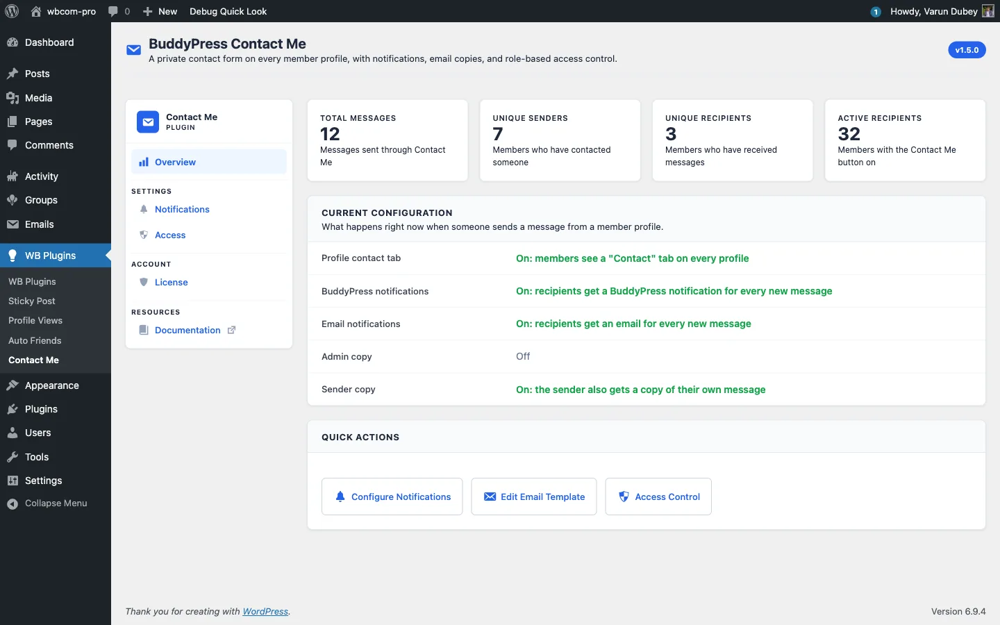

# Install & Activate the Plugin

This page walks through installing BuddyPress Contact Me and reaching its admin screen for the first time.

## Requirements

| Requirement | Minimum | Tested |
|-------------|---------|--------|
| WordPress   | 6.5     | 7.1    |
| PHP         | 8.1     | 8.5    |
| BuddyPress  | 12.0    | 14.x   |

The BuddyPress Notifications component must be active if you want in-site notification bell entries - email notifications work without it.

## Install via WordPress admin

1. Go to **Plugins → Add New**.
2. Click **Upload Plugin** and choose the ZIP you downloaded from your Wbcom Designs account.
3. Click **Install Now**, then **Activate Plugin**.

After activation, WordPress redirects you to the Contact Me admin screen automatically.

## Install via FTP

1. Unzip the plugin archive on your computer. You will get a folder named `buddypress-contact-me`.
2. Upload the folder to `/wp-content/plugins/` on your server.
3. Go to **Plugins → Installed Plugins** and click **Activate** under "Wbcom Designs - BuddyPress Contact Me".

## Install via WP-CLI

```bash
wp plugin install /path/to/buddypress-contact-me.zip --activate
```

## What happens on activation

Activation, and every later version update, does the following:

1. Creates or updates the `{prefix}contact_me` table that stores all submitted messages.
2. Installs the three BuddyPress emails (the message to the member, the sender copy and the admin copy) if they are missing. An email that already exists is never touched, so your edits at **Dashboard → Emails** survive every update.
3. Stores the schema version in the `bcm_db_version` option.

Members do not need any setup. Everyone accepts contact messages until they switch it off under **Contact > Preferences** on their own profile.

## Find the admin screen

Wbcom plugins share a single top-level WordPress menu called **WB Plugins**. After activation:

1. Open **WB Plugins** in the sidebar.
2. Click **Contact Me** in the submenu.

You land on the Overview tab. The sidebar inside the page lists the four tabs: Overview, Notifications, Access, and License.



## Recommended first-run checklist

1. **Notifications tab** - turn on at least one of "BuddyPress notification" or "Email notification" so recipients actually find out about new messages.
2. **Access tab** - confirm the role allow-lists match your community. By default every logged-in role can send and receive.
3. **License tab** - paste your license key and click **Activate License** so the plugin can pull updates straight from your dashboard.

## What's next

The License doc explains exactly what activation does and how to rotate keys. After that the Features section walks through every user-facing surface in detail.
